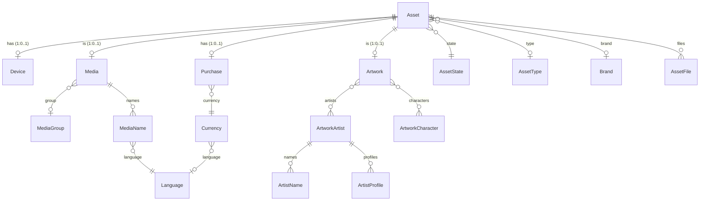
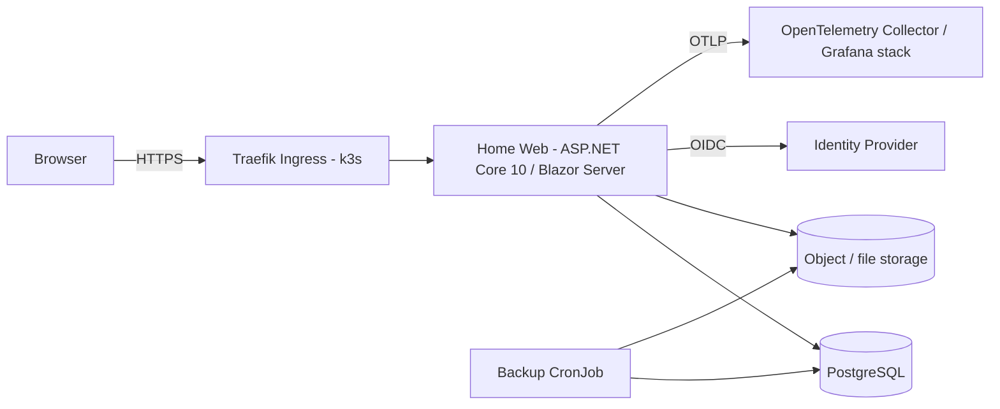
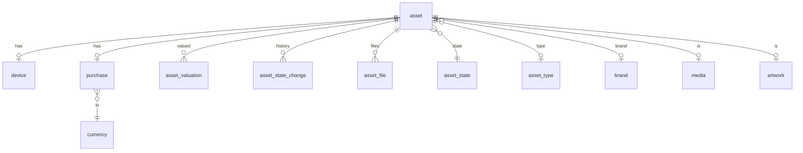
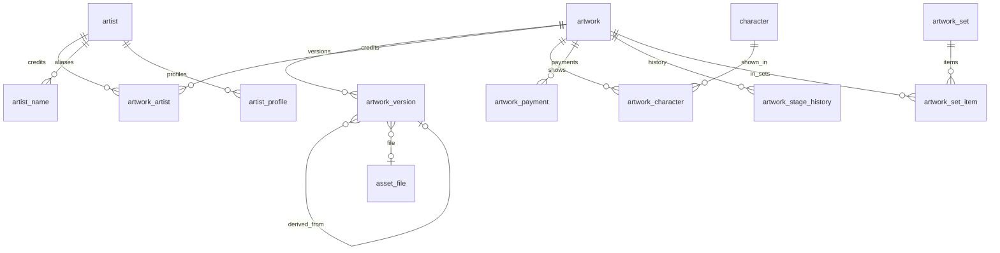
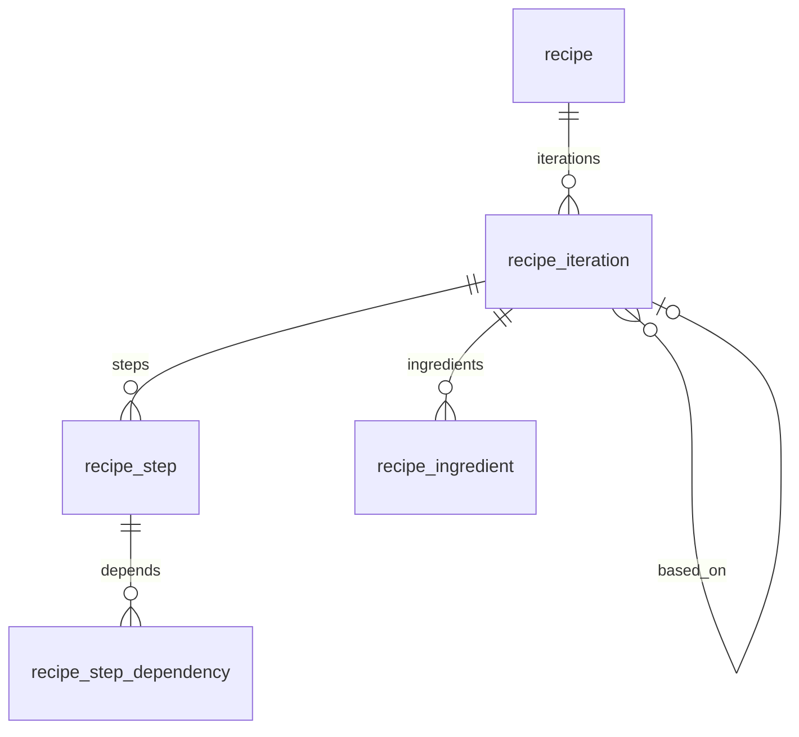

# Home – Design Documentation

Status: Draft v1 · Target: .NET 10, PostgreSQL, container on k3s

## 1. Purpose and scope

Home is a personal, single-household application with two primary goals:

1. **Asset library for media** (games, films, books, music, etc., physical and digital) including the files that belong to them (scans, covers, PDFs, digital copies).
2. **Inventory of everything owned for insurance purposes**: serial number, model number, purchase date/price/currency, current state (lost, stolen, broken, loaned…), proof-of-purchase files.

Planned but unfinished (to be completed in this upgrade):

- **Digital Artwork Manager**: characters, artists, payment information, stage, alternative versions, set information.
- **Recipes**: recipe steps shown as a Gantt diagram, recipe iterations.

Non-goals: multi-tenant SaaS, public access, mobile native apps, high-availability database (single instance is acceptable for a home cluster; backups are mandatory).

## 2. Current state (as-is)

### 2.1 Solution layout

| Project | Role |
|---|---|
| `Home.Ui.BlazorSrv` | Blazor Server (Interactive Server render mode) UI, MudBlazor 6, Serilog, Application Insights |
| `Home.Data.SqlDatabase` | EF Core 8 `DatabaseContext`, entities, migrations (SQL Server) |

Both target `net8.0`. Namespaces are `Smoehring.Home.*`. CI (`.github/workflows/homesnovalde.yml`) builds with .NET 7 and deploys to an Azure Web App; there are no tests.

### 2.2 Implemented pages

`/` (dashboard), `/Asset` (overview), `/Asset/{Uuid}` and `/Asset/New` (detail/edit, file upload, artwork/character/artist name entry), `/Asset/Print` (print selected assets), `/Media` (media overview). The nav menu already links to not-yet-existing routes: `/Sensor`, `/Device`, `/Purchases`, `/Artwork`, `/Artwork/Profiles`, `/Artwork/Characters`, `/Recipe`.

### 2.3 Current data model



Key characteristics:

- `Asset` is the hub; it carries an integer `Id` and an alternate key `Uuid` (default `NewId()`), `Creation` (default `GetDate()`), `PrintDate`, FK to `AssetState` (default 1).
- `AssetState` is seeded (Available, Lost, Stolen, Broken, Loaned, Borrowed) with `Ownership`/`Possession` flags.
- `Language` and `Currency` are seeded (de-DE, en-US, en-GB, en-AU, ru-RU; EUR, USD, AUD, GBP, RUB).
- `Purchase.Amount` is `decimal(18,2)`; `PurchaseTime` is a `DateTime` (was `datetimeoffset`, changed in a migration).
- `AssetFile` stores only metadata; the file is in Azure Blob Storage.
- `Artwork` has `IsAdult`, `Stage` (`ArtworkStages`: Unknown, Backlog, InProgress, Complete, Archived), artists and characters (many-to-many). `ArtistName`/`ArtistProfile` are not yet linked back to the artist by a foreign key in the model (no `ArtistId`); `ArtworkCharacter.IsOwned` exists.

### 2.4 Known issues / technical debt to address

| # | Finding | Impact |
|---|---|---|
| 1 | SQL-Server specific SQL in model: `NewId()`, `GetDate()` | Not portable to PostgreSQL |
| 2 | Migrations are SQL Server–specific (all generated against SQL Server) | Must be re-baselined |
| 3 | Azure-coupled: Blob/Queue clients, Application Insights, Azure Web App deployment (Azure AD auth is kept) | Cannot run on k3s unchanged |
| 4 | Blob container created with `PublicAccessType.Blob`; files addressed by an unguessable name but publicly readable | Insurance proofs (invoices, serials) should be private |
| 5 | `MigrateDatabase()` runs on every app start | Races with multiple replicas; hides failures |
| 6 | Upload limit 1 GiB per file via Blazor circuit | Memory/SignalR pressure; needs streaming/limits |
| 7 | `UserCacheService` does synchronous DB reads inside property getters | Blocks Blazor circuit threads |
| 8 | Non-nullable reference properties without initialisation, `DbContext` created manually in components (`OnInitialized`) | Warnings, lifetime leaks |
| 9 | `Device.Asset`, `Purchase.Asset` and similar are 1:1 with FK on `Asset` – serial-number data is only in `Device` and optional | Weak guarantee that every inventoried item has a serial number |
| 10 | No tests, CI uses .NET 7 and deprecated action versions (`checkout@v3`, `upload-artifact@v3`) | Quality gate missing |
| 11 | Secrets/IDs checked in (`UserSecretsId`, Application Insights resource id in csproj) | Move to configuration |
| 12 | Dead nav links | Hide until implemented |

## 3. Target architecture

### 3.1 Principles

- Keep it a **modular monolith**: one deployable web app, one database. No microservices.
- Keep Blazor (Interactive Server) – minimal change for an existing app; revisit Blazor Web App auto mode only if needed.
- **Azure Entra ID is the only retained Azure dependency (identity provider only).** All other Azure infrastructure (Blob/Queue Storage, Application Insights, Azure Web App hosting, Azure SQL/SQL Server) is removed.
- 12-factor configuration (environment variables / mounted secrets).
- Infrastructure described as code (Kubernetes manifests / Helm chart kept in repo).

### 3.2 Logical view



### 3.3 Project structure (target)

```
src/
  Home.Domain/            entities, enums, domain rules (no EF dependency)
  Home.Application/       use cases, services, DTOs, interfaces (IFileStore…)
  Home.Infrastructure/    EF Core (Npgsql), file storage, migrations
  Home.Web/               Blazor Server UI, DI composition, health, auth
tests/
  Home.Domain.Tests/
  Home.Application.Tests/
  Home.Integration.Tests/ (Testcontainers PostgreSQL)
deploy/
  docker/Dockerfile
  k8s/ (kustomize or Helm)
docs/
```

Migration path: the existing `Home.Data.SqlDatabase` becomes `Home.Infrastructure` (renamed, provider swapped); `Home.Ui.BlazorSrv` becomes `Home.Web`. A pragmatic first step is to keep the two existing projects and only add `Home.Domain` later; the rename is optional. A `Directory.Build.props` and `Directory.Packages.props` (central package management) set `net10.0`, nullable, implicit usings and `TreatWarningsAsErrors` for new code.

### 3.4 Technology decisions

| Concern | Current | Target | Rationale |
|---|---|---|---|
| Runtime | .NET 8 | **.NET 10** (LTS) | Requirement; set `global.json` to a 10.0 SDK |
| UI | Blazor Server + MudBlazor 6 | Blazor Server + latest MudBlazor compatible with .NET 10 | Minimal rewrite; MudBlazor 6 → 7/8 has breaking API changes (dialogs, `MudTable` etc.) |
| ORM | EF Core 8 SqlServer | EF Core 10 + `Npgsql.EntityFrameworkCore.PostgreSQL` | PostgreSQL requirement |
| DB | SQL Server | PostgreSQL 16+ | Requirement |
| Files | Azure Blob (**removed**) | `IFileStore` abstraction; default implementation on S3-compatible storage (MinIO / Garage) or a PVC (local-path / Longhorn) | No cloud dependency; private by default |
| Queue | Azure Queue client registered (unused) | Remove | Azure removal; YAGNI; use `Channel<T>`/`BackgroundService` if needed |
| Auth | Azure AD (Microsoft.Identity.Web) | **Azure Entra ID stays** (OIDC via `Microsoft.Identity.Web`, updated to a .NET 10 compatible version); cookie session | Decision: Entra ID is retained; no other Azure service is used |
| Logging | Serilog + App Insights (**removed**) | Serilog console (JSON) + OpenTelemetry traces/metrics | Works with k3s + Grafana/Loki |
| Health | `/health` with DbContext check | `/health/live`, `/health/ready` | k8s probes |
| CI/CD | GitHub Actions → Azure Web App (**removed**) | GitHub Actions → build, test, push image to GHCR → Argo CD/Flux or `kubectl apply` | |

## 4. Data design

### 4.1 General conventions (PostgreSQL)

- Schema `home`; snake_case table/column names (`EFCore.NamingConventions` → `UseSnakeCaseNamingConvention`).
- Keys: keep `int` identity keys (`GENERATED BY DEFAULT AS IDENTITY`) plus a public `uuid` column (`DEFAULT gen_random_uuid()`, built in since PG 13) for URLs.
- Timestamps: `timestamptz`, always UTC (`DateTimeOffset`/`Instant`). Purchase date is a `date` (`DateOnly`) – the time of purchase is not meaningful and avoids timezone shifts.
- Money: `numeric(18,2)` + ISO 4217 currency code FK. Never use float.
- Case-insensitive uniqueness (names): `citext` extension or `lower(name)` unique index.
- Search: `pg_trgm` GIN index on names for fuzzy search; optional `tsvector` for full text.
- Soft delete (`deleted_at`) on `asset`, `artwork`, `recipe` (insurance history must not silently vanish); global query filter.
- Optimistic concurrency: `xmin` system column as concurrency token (`UseXminAsConcurrencyToken`/`IsRowVersion`).
- Audit columns `created_at`, `updated_at` set in `SaveChanges` override.
- Enums stored as text (or PostgreSQL enums via Npgsql mapping) – prefer lookup tables for user-extensible ones (state, type) and text enums for fixed ones (stage).

### 4.2 Core asset / insurance model

Changes versus today:

- **Serial number** is first-class and indexed (`device.serial_number`, unique per `brand + model` when present). For assets flagged `requires_serial` (by asset type) the UI warns when missing.
- Introduce **`asset_valuation`** (date, amount, currency, reason: purchase / appraisal / replacement value) so insurance values can be tracked over time without overwriting the purchase.
- Introduce **`asset_file.kind`** (Invoice, Photo, Manual, Scan, Digital, Other) so proof-of-purchase can be exported in one go.
- `asset.location` (free text or `location` table: room/box/storage) – optional.
- Keep `Purchase` 1:0..1 with vendor (`vendor` text, `order_number`, `warranty_until`).
- `AssetState` history table `asset_state_change` (asset, from, to, at, note) – required for loss/theft claims.



### 4.3 Media library

Unchanged conceptually: `media` (1:1 with asset), `media_group` (series/collection) with `group_order`, `media_name` per `language` (multiple localized titles). Additions: `media.kind` (Game, Film, Book, Music, Software), `media.release_date`, external id (e.g. ISBN/IMDb/Steam id) as `media_external_id(media_id, system, value)`.

### 4.4 Digital Artwork Manager (new)

Requirements → model:

| Requirement | Design |
|---|---|
| Characters on the artwork | `artwork_character` (artwork_id, character_id) many-to-many; `character` (name, `is_owned`, notes, optional `series`) |
| Artists who worked on it | `artwork_artist` link with `role` (Sketch, Lineart, Color, Background, Commission, Other); `artist` aggregate with `artist_name` (aliases, FK `artist_id`, one flagged primary) and `artist_profile` (type, url, FK `artist_id`) – the missing FKs in the current model are added |
| Payment information | `artwork_payment`: artwork_id, optional artist_id, amount, currency_id, paid_at (date), method (PayPal, Bank, Cash, Other), reference, kind (Deposit, Final, Tip, Refund), invoice file (`asset_file_id`). Total paid is computed, not stored. Can also tie to `purchase` for finished commission |
| Stage of the artwork | `artwork.stage` enum extended: Unknown, Backlog, **Commissioned, Sketch, Lineart, Colored**, InProgress, Complete, Archived. Plus `artwork_stage_history` (stage, at, note) |
| Alternative versions | `artwork_version`: id, artwork_id, label (e.g. "Uncensored", "Alt outfit", "Transparent PNG", "WIP"), `is_primary`, `parent_version_id` (derived from), `asset_file_id`, notes, created_at. One primary per artwork (partial unique index `WHERE is_primary`) |
| Set information | `artwork_set` (name, description, planned_count) and `artwork_set_item` (set_id, artwork_id, `position`, `is_variant_of_position`); an artwork can belong to several sets. Completion % = items / planned_count |



Business rules:

- Every artwork has exactly one linked `asset` (keeps the insurance/inventory story consistent) – created automatically.
- `IsAdult` artworks are hidden behind a user preference toggle and never shown on the dashboard or in print output.
- Changing `stage` appends history; moving to `Complete` requires a primary version with a file.
- Deleting an artist with credits is blocked (restrict).

UI: `/Artwork` (grid/gallery with filters: stage, artist, character, set, adult), `/Artwork/{uuid}` (tabs: Overview, Versions, Credits, Payments, Sets), `/Artwork/Profiles` (artists), `/Artwork/Characters`, `/Artwork/Sets`. Thumbnails are generated server-side (ImageSharp/NetVips) at upload and stored next to the original.

### 4.5 Recipes (new)

| Requirement | Design |
|---|---|
| Recipe | `recipe` (uuid, title, description, servings, source_url, tags, `active_iteration_id`) |
| Steps in a Gantt diagram | `recipe_step` per iteration: `name`, `instructions`, `duration` (interval), `start_offset` (interval from recipe start), `is_active_work` (hands-on vs. waiting), `sort_order`. `recipe_step_dependency (step_id, depends_on_step_id, type FS/SS)` |
| Recipe iterations | `recipe_iteration` (recipe_id, number, created_at, change notes, rating, `based_on_iteration_id`, cooked_on, photos via `asset_file`). Iterations copy-on-create from the previous one so steps/ingredients can be changed without losing history |
| Ingredients | `recipe_ingredient` (iteration_id, name, quantity numeric, unit, optional step_id) |



**Gantt scheduling**: start time of a step = max(end of all dependencies) unless `start_offset` is pinned. Computation is a pure domain function (topological sort; cycles rejected on save) producing `(step, start, end)`; it is unit tested. Rendering: a lightweight SVG component in Blazor (rows per step, bars sized by duration, hands-on vs. waiting colour, dependency arrows, optional "finish at HH:mm" reverse planning that back-calculates the start time). A third-party Gantt library is not needed and is avoided to keep the dependency surface small.

## 5. Application design

- **Layering**: UI components call application services (`IAssetService`, `IArtworkService`, `IRecipeService`, `IFileStore`); components no longer create `DbContext`s themselves. Services use `IDbContextFactory<HomeDbContext>` (Blazor Server requires per-operation contexts) and are scoped.
- **Async everywhere**; replace `UserCacheService` getters with `async` lookups cached via `IMemoryCache` (lookup data: states, currencies, languages).
- **Validation**: FluentValidation or DataAnnotations; server-side rules live in the application layer.
- **Paging/Sorting**: server-side paging in all overview tables (`MudTable.ServerData`).
- **Errors**: global error boundary in `MainLayout`; ProblemDetails for the API endpoints.
- **Minimal API endpoints** (authorised) for file download `/files/{uuid}` (streams from `IFileStore`, checks ownership/auth, sets cache headers) and for health.
- **Export**: insurance report (PDF/CSV/ZIP) of all owned assets with serial, purchase info, valuation, photos and invoice files (`/Asset/Report`).
- **Print**: existing print page is kept (labels with QR code to `/Asset/{uuid}` recommended).

### 5.1 File storage

```csharp
// contract (illustrative)
interface IFileStore {
    Task<StoredFile> SaveAsync(Stream content, string fileName, string contentType, CancellationToken ct);
    Task<Stream> OpenReadAsync(string storageKey, CancellationToken ct);
    Task DeleteAsync(string storageKey, CancellationToken ct);
}
```

- Implementations: `S3FileStore` (AWSSDK.S3 against MinIO/Garage – recommended, allows scaling to >1 replica) and `LocalFileStore` (PVC, ReadWriteOnce, restricts to 1 replica – simplest for a home cluster).
- Files are **private**; served through the authorised endpoint. Keys stay `{assetUuid:N}x{guid:N}{ext}` for compatibility with the existing `asset_file.storage_file_name`.
- Upload: stream to storage (no full buffering); max size configurable (default 200 MB); content-type sniffing and extension allow-list; SHA-256 recorded in `asset_file.sha256` (dedup, integrity).
- Migration of existing blobs: one-off tool copies each blob listed in `AssetFile` from Azure to the new store and verifies size/hash.

## 6. Security

- All routes require authentication (existing fallback policy kept). Authorization: a single `Household` role/claim; optional `Admin` for destructive operations.
- Entra ID sign-in (OIDC, code flow with PKCE) with the single-tenant app registration; redirect URI is the public k3s ingress URL (`/signin-oidc`), `SameSite=Lax` cookies, `Secure`, data-protection keys persisted (see 7.5) so sessions survive pod restarts.
- Forward headers configured (`UseForwardedHeaders`) since TLS terminates at the ingress; HSTS and HTTPS redirect only at ingress level.
- Secrets only from Kubernetes Secrets (ideally sealed-secrets / SOPS); no secrets in git, remove the committed ids from csproj/appsettings.
- Containers: non-root user, read-only root filesystem, dropped capabilities, `seccompProfile: RuntimeDefault`.
- NetworkPolicy: app → postgres, app → storage, app → IdP; deny others. Postgres not exposed outside the namespace.
- Antiforgery stays enabled; file endpoints use authorisation; upload validation (size, type).
- Dependency hygiene: Dependabot (NuGet, Docker, Actions), `dotnet list package --vulnerable` in CI, image scan (Trivy).
- Privacy: adult-flag content, payment data and serial numbers are sensitive; logs must not include them (disable `EnableSensitiveDataLogging` outside Development – already so).

## 7. Deployment on k3s

### 7.1 Container image

Multi-stage Dockerfile:

- Build: `mcr.microsoft.com/dotnet/sdk:10.0` → `dotnet publish -c Release -o /app --no-self-contained`.
- Runtime: `mcr.microsoft.com/dotnet/aspnet:10.0` (or the `-noble-chiseled` variant for a smaller, shell-less image). `USER $APP_UID`, `ASPNETCORE_URLS=http://+:8080`, `EXPOSE 8080`.
- Multi-arch (`linux/amd64`, `linux/arm64`) because k3s homelabs frequently run on ARM (Raspberry Pi). `docker buildx` in CI.
- `.dockerignore` excludes `bin/`, `obj/`, `.git`.
- `libman` restore (bootstrap-icons) happens at build or the files are vendored – the runtime image must not need network access.

### 7.2 Kubernetes objects

| Object | Notes |
|---|---|
| Namespace `home` | |
| Deployment `home-web` | 1 replica (Blazor Server needs sticky circuits; with >1 replica enable ingress cookie affinity). Requests 100m/256Mi, limits 1 CPU/768Mi. Liveness `/health/live`, readiness `/health/ready`, startup probe with generous threshold |
| Service `home-web` | ClusterIP 8080 |
| Ingress | Traefik (k3s default), TLS via cert-manager; WebSocket support is default in Traefik; sticky cookie annotation if scaled |
| ConfigMap | non-secret settings (`Storage__Provider`, OIDC authority, log level) |
| Secret | `ConnectionStrings__Postgres`, `Oidc__ClientSecret`, storage credentials |
| PostgreSQL | Preferred: **CloudNativePG** `Cluster` (1–2 instances, PVC on local-path/Longhorn, scheduled backups to S3). Simple alternative: StatefulSet with `postgres:16` and a PVC |
| PVC `home-data` | Only when `LocalFileStore` is used; also holds Data Protection keys (or keys in the DB via `PersistKeysToDbContext`) |
| Job `home-migrate` | Runs EF migrations (see 7.3) as a Helm hook / Argo PreSync hook |
| CronJob `home-backup` | `pg_dump` + file store sync to off-cluster target (e.g. restic/rclone) |
| NetworkPolicy, PodDisruptionBudget (optional), ServiceAccount (no token automount) | |

### 7.3 Database migrations

- Remove `MigrateDatabase()` on startup for production. Generate an **idempotent SQL script** or an EF **migration bundle** (`dotnet ef migrations bundle`) in CI and run it as a Kubernetes Job/init step before the Deployment rolls out. Development may keep auto-migrate behind `Database:AutoMigrate=true`.
- Because of the provider change, the existing SQL Server migrations are **archived** and a new initial PostgreSQL migration (`Initial`) is generated from the new model.

### 7.4 Configuration (environment variables)

```
ConnectionStrings__Postgres=Host=home-pg-rw;Database=home;Username=home;Password=CHANGE_ME;
Database__AutoMigrate=false
Storage__Provider=S3|Local
Storage__S3__ServiceUrl, Storage__S3__Bucket, Storage__S3__AccessKey, Storage__S3__SecretKey
Storage__Local__Path=/data/files
AzureAd__Instance, AzureAd__TenantId, AzureAd__ClientId, AzureAd__ClientSecret (Entra ID only)
OTEL_EXPORTER_OTLP_ENDPOINT=http://otel-collector:4317
ASPNETCORE_FORWARDEDHEADERS_ENABLED=true
```

### 7.5 Blazor Server specifics

- Persist Data Protection keys (PVC or DB) – otherwise every restart logs everyone out and breaks antiforgery tokens.
- Remove `AddApplicationInsightsTelemetry`; use OpenTelemetry (`AddAspNetCoreInstrumentation`, `AddNpgsql`, `AddHttpClientInstrumentation`, OTLP exporter).
- Graceful shutdown: `terminationGracePeriodSeconds: 30`; circuits reconnect automatically.
- SignalR via WebSockets through Traefik; configure `CircuitOptions.DisconnectedCircuitRetentionPeriod` sensibly.

### 7.6 CI/CD pipeline (GitHub Actions)

1. `dotnet restore/build/test` with .NET 10 SDK (`actions/setup-dotnet@v4`, `actions/checkout@v4`).
2. Integration tests with Testcontainers PostgreSQL.
3. `docker buildx build --platform linux/amd64,linux/arm64` → push `ghcr.io/smoehring/home:<sha>` and `:latest` from `main`.
4. Trivy scan, `dotnet list package --vulnerable --include-transitive`.
5. Deploy: GitOps (Argo CD/Flux watching `deploy/k8s`) updating the image tag, or `kubectl set image` via a self-hosted runner / kubeconfig secret.

### 7.7 Backup and restore

- PostgreSQL: nightly `pg_dump`/CNPG barman backup, 30-day retention, quarterly restore drill.
- Files: nightly sync to off-site storage; invoices and photos are insurance evidence, so off-site copy is required.
- Document RPO 24 h / RTO 4 h.

### 3.5 Azure removal checklist

Retained: Microsoft Entra ID (authentication only).

Removed, with the replacement:

| Azure item (where) | Replacement |
|---|---|
| `Azure.Storage.Blobs`, `Azure.Storage.Files.Shares`, `Azure.Storage.Queues`, `Microsoft.Extensions.Azure`, `AzureClientFactoryBuilderExtensions.cs`, `AddAzureClients` in `Program.cs`, `BlobServiceClient` in `AssetDetail.razor.cs` | `IFileStore` (S3-compatible or PVC), see 5.1 |
| `ConnectionStrings:AzureStorage` | `Storage__*` settings |
| `Microsoft.ApplicationInsights.AspNetCore`, `Serilog.Sinks.ApplicationInsights`, `ApplicationInsights` section, `ApplicationInsightsResourceId` in csproj, `AddApplicationInsightsTelemetry` | Serilog console + OpenTelemetry |
| `Properties/ServiceDependencies/*`, `serviceDependencies*.json` (Azure storage ARM template) | Delete |
| `.github/workflows/homesnovalde.yml` (Azure Web App deploy, `publish-profile` secret) | Image build/push + k3s deployment (7.6) |
| SQL Server (`Microsoft.EntityFrameworkCore.SqlServer`) | PostgreSQL / Npgsql |
| Existing Azure data (SQL database, blob container) | One-off migration (phase 3/4), then decommission the Azure resources |

## 8. Migration plan

| Phase | Deliverables |
|---|---|
| 0. Preparation | `global.json`, central package management, add tests project, fix CI to .NET 10, Dependabot, remove committed Azure identifiers |
| 1. Platform upgrade | `net10.0`, EF Core 10, MudBlazor upgrade, fix breaking changes, nullable warnings, async lookups |
| 2. PostgreSQL | Npgsql provider, replace `NewId()/GetDate()` (`gen_random_uuid()`, `now()` or client-side defaults), naming convention, new `Initial` migration, `Purchase.PurchaseTime` → `DateOnly` |
| 3. Data migration | One-off ETL tool (SQL Server → PostgreSQL): copy lookup tables, then assets/devices/purchases/media/artwork keeping ids and uuids; reset identity sequences (`setval`) afterwards; row-count and checksum verification |
| 4. Storage | `IFileStore`, S3/Local implementations, blob copy tool, private file endpoint, remove Azure SDKs |
| 5. Auth | Keep Entra ID / Microsoft.Identity.Web; update the package, set the redirect URI for the k3s ingress, load settings from Kubernetes Secret/ConfigMap |
| 6. Containerisation | Dockerfile, k8s manifests/Helm chart, health endpoints, OpenTelemetry, migration job, backups |
| 7. Insurance features | Valuation, state history, file kinds, insurance report export |
| 8. Artwork manager | Schema additions, services, pages (4.4) |
| 9. Recipes | Schema, scheduler domain logic, Gantt component, iterations UI (4.5) |
| 10. Hardening | Load/soak test, security review, documentation, cut-over |

Cut-over (Azure resources other than the Entra ID app registration are decommissioned afterwards): freeze writes on the old app → run ETL → verify → switch DNS/ingress → keep Azure resources read-only for 30 days → decommission.

Rollback: until decommissioning, the old SQL Server database and blob container stay untouched.

## 9. Quality strategy

- **Unit tests**: domain rules, Gantt scheduler (cycles, parallel steps, reverse planning), price/valuation calculations, stage transitions.
- **Integration tests**: EF model against a real PostgreSQL (Testcontainers) – migrations apply cleanly, constraints (unique, restrict deletes), query filters, concurrency.
- **UI tests**: bUnit for components with logic; a small Playwright smoke suite (login stub, create asset, upload file).
- **Static analysis**: .NET analyzers, `dotnet format --verify-no-changes`, nullable enabled.
- **Observability**: request/DB traces, business metrics (assets count, upload failures), structured logs with correlation id.
- Definition of done: tests green, no new warnings, migration reviewed, docs updated.

## 10. Risks and open questions

| Risk / question | Mitigation / proposed answer |
|---|---|
| MudBlazor major-version breaking changes | Upgrade in an isolated phase; keep UI unchanged first |
| SQL Server → PostgreSQL data differences (collation/case-sensitivity, datetime types) | `citext`/lower indexes; ETL verification; keep uuids |
| Single replica limits availability | Acceptable for home use; S3 storage + CNPG leaves the door open to scale |
| Identity provider | Decided: Entra ID stays. The cluster needs outbound HTTPS to `login.microsoftonline.com`; login is unavailable if Entra is unreachable |
| File storage choice (PVC vs. S3) | Open: default to S3-compatible (Garage/MinIO) if the cluster has >1 node, else PVC |
| Adult content handling and legal/privacy | Default hidden, never in exports unless chosen |
| Scope creep of unfinished features | Deliver in phases; insurance and media library stay the priority |

## 11. Glossary

- **Asset** – anything inventoried (physical item, media item, artwork).
- **Media** – an asset that is a media title; may have several localized names and belong to a group.
- **Artwork** – a digital artwork asset with credits, versions, payments and set membership.
- **Iteration** – a versioned variation of a recipe.
- **Set** – an ordered collection of artworks (e.g. a themed series).

## 12. Implementation status

The first implementation lives in `src/` (see README). The old code is kept under `legacy/`.

Implemented: domain model for assets/insurance, media, artworks and recipes; Gantt scheduler; application services; PostgreSQL model and `Initial` migration; local file store with private download endpoint; Entra ID sign-in; health endpoints; OpenTelemetry; Blazor pages (assets, artworks, artists, characters, sets, recipes with Gantt view); insurance CSV report; Dockerfile, k8s manifests, CI; unit and PostgreSQL integration tests.

Not yet implemented: S3 file store, data/blob migration tooling from the legacy SQL Server/Azure data, thumbnails, media library pages, valuation and artwork-version file upload UI, print labels, image-based UI tests. The migration Job in `deploy/k8s` and the `bundle` Docker stage are untested.
